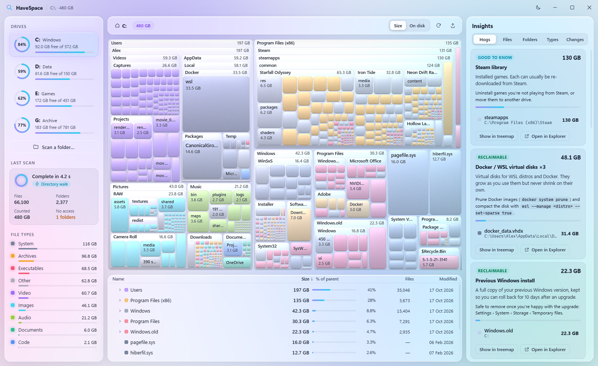
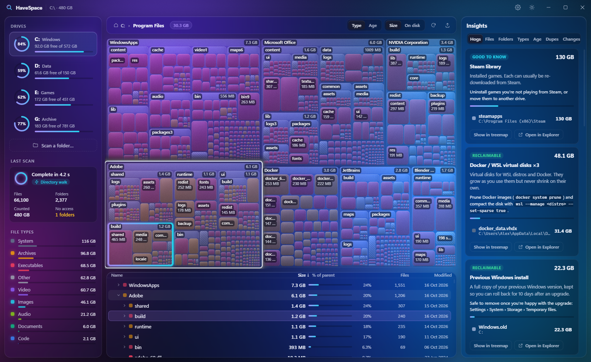

# DiskLens

A fast disk space analyzer for Windows 11: WizTree-class scanning with a glassmorphism treemap.

> **Status:** milestones (a)–(e) are done: the scanner and CLI, the design mockup, the glass treemap on real
> scan data in Tauri, tree list ↔ treemap linking with space-hog insights and safe actions, and the NTFS MFT
> fast path. The MFT path scans C: (1.06M files) in **4.5–6.3 s**, against about 30 s for the walk.
> Next up: (f) polish (export, cache, packaging).



## Layout

```
crates/disklens-core      scanner engine: arena tree, parallel walk, MFT reader, treemap layout, categories, actions
crates/disklens-cli       `disklens` command-line tool (scan, bench, compare, fixture)
crates/disklens-fixtures  fake directory tree generator (files, hard links, junctions, symlinks)
app/ui                    React + TypeScript + WebGL2 front end
app/ui/src-tauri          Tauri 2 shell: scan session, binary layout IPC, Mica backdrop
docs/mockup, docs/screens screenshots (fake-data mockup / real app)
scripts                   screenshots, window capture, UI benchmark and the end-to-end UI flow (ui-flow.mjs)
```

## Desktop app

```bash
npm --prefix app/ui install
```

Run in development (hot-reloading UI, release-optimised scanner):

```bash
npm --prefix app/ui run tauri dev -- --release
```

Build an installer (`target\release\bundle\nsis\…-setup.exe`). This is not verified yet: packaging is part of
milestone (f), and the Tauri bundler downloads NSIS the first time it runs.

```bash
npm --prefix app/ui run tauri build
```

Command-line options of the app:

- `DiskLens.exe D:\Games` starts scanning that folder or drive immediately.
- `--focus <path>` zooms the treemap to a folder once the scan finishes.
- `--theme light|dark` picks the theme.

How the app works:

- **Streaming:** the scan runs on a background thread. `scan-progress` events reach the UI every 120 ms, and the UI
  pulls a fresh layout at most every 450 ms, so the treemap fills in while the scan runs. Folders that are still
  being read shimmer.
- **Binary layout:** `treemap_layout` returns a binary payload (48 bytes per block, plus names; see
  `src-tauri/src/encode.rs`) rather than JSON. The UI decodes it straight into the WebGL instance buffer.
- **Animation:** zooming plays a 300 ms camera morph. Streamed refreshes and window resizes glide blocks to their new
  positions in 240 ms, and labels move with them.
- **Window:** frameless with a custom title bar. The Mica backdrop comes from `window-vibrancy`, falling back to
  Acrylic on Windows 10. The aurora is drawn at 88% opacity so Mica tints through.

In a plain browser (`npm --prefix app/ui run dev`), the UI uses a mock backend with the fake C: tree. A banner in the
title bar says so. This keeps design review and screenshots possible without Tauri, and "deleting" there only
edits the fake data.

### Working with results



- **Treemap and tree list are linked both ways.**
  - Clicking a block zooms into its top-level folder and selects the block. The selection gets a violet-to-cyan
    ring, and the tree list expands to that row and scrolls it into view.
  - Hovering a row lights up its block, and hovering a block highlights its row.
  - Double-click a folder row, or press Enter on a selection, to zoom into it. Backspace or Esc zooms out.
- **Right-click any block, row or insight item** for *Zoom into folder*, *Open in Explorer* (opens the folder with the
  item selected), *Copy path*, or *Send to Recycle Bin…*. Right-clicking a "small files" block acts on the folder
  that holds those files. Delete and Ctrl+C work on the selection too.
- **Insights:**
  - **Hogs:** known space hogs explained in plain English, each with Windows' own way to reclaim the space:
    hibernation and page files, WinSxS, Windows.old, the Recycle Bin, System Restore, Temp folders, browser caches,
    Windows Update downloads, node_modules, .git, Docker/WSL virtual disks and Steam libraries. Nested matches such
    as `Temp\Temp` count once.
  - **Files:** the 50 largest files.
  - **Folders:** folders ranked by the data held directly inside them, not counting subfolders.
  - **Types:** a stacked category bar plus a per-extension breakdown.

### Sending to the Recycle Bin: safety rules


1. **Confirmation every time.** The dialog shows the name, full path, size and file count, and Cancel has the focus.
2. **Protected locations are refused** (`crates/disklens-core/src/protect.rs`):
   - **Refused:** drive roots, `C:\Windows`, System Volume Information, `$Recycle.Bin`, the page, hibernation and
     swap files, the Program Files and ProgramData roots, `C:\Users` and profile roots, and `AppData`.
   - **Allowed with a warning in the dialog:** anything inside Program Files, ProgramData or AppData.
3. **Never a permanent delete.** Left to itself, Windows *permanently* deletes anything it can't recycle (a drive
   without a Recycle Bin, a bin that's switched off, or an item bigger than the bin's limit), and it doesn't say so
   in advance. `tests/recycle.rs` proves it: the shell's `PreDeleteItem` reports identical flags for both cases.
   DiskLens therefore:
   - **pre-checks every item** against the volume's Recycle Bin settings (`NukeOnDelete` and `MaxCapacity`, the same
     registry values Explorer uses) and refuses anything that couldn't be recycled;
   - **keeps a tripwire** on the operation: if Windows ever reports a delete that produced no Recycle Bin item, the
     remaining items are aborted and the UI reports it.
4. **Totals update in place.** Sizes, the treemap, the tree list and the insights all update without a rescan.

The real Recycle Bin tests are ignored by default because they put small fixture files into your bin:

```bash
cargo test --release -p disklens-core --test recycle -- --ignored --test-threads=1
```

## Prerequisites

- Windows 10/11 x64
- Rust stable (MSVC toolchain): `winget install Rustlang.Rustup`
- Visual Studio 2022 Build Tools with the **Desktop development with C++** workload
- Node.js 20+ (for the UI)

## Scanner CLI

```bash
cargo build --release
```

```bash
target\release\disklens.exe scan C:\ --top 20
```

Options:

| flag | meaning |
|---|---|
| `--method auto\|walk\|findfirst\|mft` | `auto` tries the MFT and falls back to the walk (default) |
| `--threads N` | walk worker threads (default: 2 × logical CPUs, 8–64) |
| `--json` | machine-readable output, including the inaccessible folder list |
| `--quiet` | no live progress line |

Ctrl+C cancels a scan cleanly; partial results are still printed.

Benchmark repeated scans (run 1 is cold-ish, later runs hit the OS cache):

```bash
target\release\disklens.exe bench C:\ --runs 3 --method walk
```

Generate a fake tree to scan:

```bash
target\release\disklens.exe fixture D:\tmp\fake --files 1000000 --depth 12
```

Set `DISKLENS_PROFILE=1` to print the time split between workers and the tree builder.

### How the walk works

- Each folder is opened once and read in 256 KiB batches with
  `GetFileInformationByHandleEx(FileIdExtdDirectoryInfo)`. Every entry already carries the logical size,
  size on disk, a 128-bit file ID and the reparse tag, so there are **no per-file stat calls**.
- If a volume doesn't support that call, the scanner downgrades automatically to `FileIdBothDirectoryInfo`, then to
  `FindFirstFileExW(FindExInfoBasic, FIND_FIRST_EX_LARGE_FETCH)`. FAT drives and some network shares need this. On the
  `FindFirstFileExW` path, size on disk is estimated from the cluster size, and hard links can't be detected.
- **Hard links** are counted once: each file ID is checked against a per-scan set. Every name still shows in the tree.
- **Junctions and symlinks** (any reparse tag with the name-surrogate bit) are recorded but never followed.
  OneDrive placeholders and other non-link reparse points *are* entered.
- Folders that can't be opened are flagged and listed in the scan summary.
- Worker threads enumerate folders. A single builder thread owns the tree, appends each folder's entries as one
  contiguous block of children, and pushes sizes up the ancestor chain right away. This keeps a partially scanned
  tree consistent, which the UI uses to stream results.

### Memory

The tree is stored as columns indexed by `u32` node IDs (`parent`, `first_child`, `child_count`, `size`,
`alloc`, `files`, `dirs`, `mtime`, `ext`, `flags`). All names live in one interned string buffer, and extensions are
interned to `u16`. That works out to about 53 bytes per node plus the name.

Inspect one folder of a scan (useful for checking totals):

```bash
target\release\disklens.exe scan C:\Users\me --show AppData\Local
```

## Benchmarks (this machine)

Ryzen 5 5500 (6C/12T), NVMe SSD, Windows 11, Defender real-time protection on.

| target | files / folders | method | time | peak memory |
|---|---|---|---|---|
| `C:\` (300 GB) | 944k / 240k | walk, cold | 72.8 s | 151 MB |
| `C:\` (300 GB) | 944k / 240k | walk, warm | **20.6 s** | 153 MB |
| `C:\` (318 GB*) | 1.03M / 240k | FindFirstFileEx, warm | 20.8 s | 137 MB |
| `C:\Program Files` | 106k / 12k | walk, warm | 0.5–1.0 s | 23 MB |
| `C:\` in the app, streaming | 962k / 244k | walk, warm | 22–27 s | – |
| `C:\` (343 GB†) | 1.06M / 264k | **MFT**, first run | **6.3 s** | 309 MB |
| `C:\` (343 GB†) | 1.06M / 264k | **MFT**, warm | **4.5 s** | 309 MB |
| `C:\` (as admin) | 1.06M / 264k | walk, same session | 29.6 s | – |
| `G:\` (597 GB) | 244k / 27k | **MFT**, warm | **0.42 s** | 60 MB |

The MFT rows come from `scripts\bench-mft.ps1`; the full output is in `docs/bench-mft.txt`.

- **Throughput:** C: reads at about 330 MB/s of MFT and is read-bound (parsing keeps up with the reads); G: reaches
  about 750 MB/s.
- **Memory:** the 309 MB peak is the 109 MB tree plus 144 MB of parsed records, which are freed once the tree is
  built.
- **History:** the first version parsed each record into heap-allocated names and read with a single thread. It
  took 7.9–10 s and peaked at 492 MB (`docs/bench-mft-v1.txt`).

† The MFT sees about 10 GB the walk can't, even as administrator: `System Volume Information` (8 GB of restore
points) and NTFS's own files (`$MFT` alone is 1.3 GB). Elsewhere, top-level folders agree with the walk within
±0.9%, and file counts are within 89 of each other out of 1.06M. The small per-folder shifts are hard-linked files
being attributed to a different folder (Windows vs Program Files).

Wall times on C: vary by roughly ±30% from run to run on this machine, depending on background load. In the same
session the CLI took 25–36 s. The app's tree builder is busy for only about 1.3 s of a scan, so streaming the
layout to the UI costs almost nothing. After the scan, the tree arrays are trimmed to size: 100 MB for 1.2M nodes.

\* FindFirstFileEx counts hard links once per name, so it over-reports C: by 18 GB (83k duplicate names, mostly WinSxS).

What these numbers show:

- **Warm scans are I/O-bound.** The tree builder is busy for only 1.2 s of a 20 s scan. Everything else is spent
  opening and enumerating folders.
- **`C:\Windows` is the bottleneck:** 156k folders at a nearly fixed cost per folder, and wall time stops improving
  beyond 2 threads (1 thread: 23 s; 4–48 threads: about 12 s). Opening folders by file ID instead of by path made no
  difference, so path parsing isn't the cause. The serialization is below the API, most likely file-system filter
  drivers such as Defender on-access scanning.
- **The first cold walk of C: missed the 60 s target** (72.8 s); warm walks are well under it. As administrator, the
  MFT path avoids per-folder opens entirely and scans C: in 4.5–6.3 s, under the 10-second goal.

### Treemap renderer

These figures come from headless Edge on an RTX 4060, at 1600×980:

| visible blocks | GPU time per frame | layout (JS, mockup) |
|---|---|---|
| 10,000 | 0.61 ms | 3.9 ms |
| 60,000 | 1.88 ms (~530 fps equivalent) | 24 ms |

The Rust layout handles 60k visible blocks in 2.5 ms. For 900k files it takes 18 ms, because files too small to see
are merged.

## Tests

```bash
cargo test --release --workspace
```

The tests cover:

- **Aggregation:** incremental totals match a full recompute, deleting a folder subtracts its size from every parent,
  and links and hard-link duplicates count zero.
- **Real fixture trees:** hard links, junctions (including one that loops back to its parent), symlinks (skipped
  without Developer Mode), access-denied folders, cancel, live progress, and walk vs FindFirstFileEx parity.
- **Treemap layout:** areas proportional to size, no overlaps, children inside their parent, merging of tiny blocks,
  hit-testing and speed.
- **Space hogs and protection:** every hog rule, nested matches counted once, deleted items dropping out, and which
  paths are refused or warned about.
- **Recycle Bin** (ignored by default; see above): a normal file is recycled; an 8 TiB sparse file is refused
  untouched; and the tripwire reports the permanent delete Windows makes when the pre-check is skipped.

For the UI there's an end-to-end flow driven by real mouse and keyboard input: hover, click-zoom with selection,
linked hover, context menu, confirm, recycle and the insights tabs. Each step is saved as a screenshot.

```bash
node scripts/ui-flow.mjs
```

That runs against the browser build. To drive the real app instead, start it on a throwaway folder (the flow
really recycles one item) with
`WEBVIEW2_ADDITIONAL_BROWSER_ARGUMENTS=--remote-debugging-port=9335`, then add `--attach=9335`.

## UI mockup

```bash
npm --prefix app/ui install
```

```bash
npm --prefix app/ui run dev
```

Open http://localhost:1420. URL parameters for design review:

- `?theme=light`
- `?zoom=Users/Aidid`
- `?hover=pagefile.sys` (pins the hover state)
- `?stress=60000&fps` (stress test with an FPS overlay)

Screenshots: `scripts\screenshot.ps1 -Query "theme=light" -Out docs\mockup\light.png`.

## Running as administrator (MFT fast path)

Reading the Master File Table requires opening the raw volume (`\\.\C:`), which only an elevated process can do.

- **App:** click *Restart as administrator* on the drive picker, or the "Scan much faster…" hint in the sidebar after
  a drive scan. DiskLens relaunches through the UAC prompt and rescans the same drive. You can also right-click
  DiskLens and choose *Run as administrator*.
- **CLI:** open *Terminal (Admin)*. Scan with the MFT:

  ```bash
  target\release\disklens.exe scan C:\ --method mft
  ```

  Time the MFT and compare it against the walk, per top-level folder:

  ```bash
  target\release\disklens.exe compare C:\
  ```

  Benchmark every NTFS drive and write `docs\bench-mft.txt`:

  ```bash
  powershell -ExecutionPolicy Bypass -File scripts\bench-mft.ps1
  ```

Without elevation, `--method auto` (the default) tries the MFT, gets "reading the MFT needs administrator rights",
and falls back to the walk. The fallback reason shows in the CLI output and in the app's scan badge tooltip. Folder
scans always use the walk.

How the MFT path works (`crates/disklens-core/src/scan/mft/`):

1. **Find the MFT.** `FSCTL_GET_NTFS_VOLUME_DATA` gives its location and record size. File record 0 is `$MFT`
   itself; its `$DATA` runlist gives the MFT's own extents on disk.
2. **Read and parse.** A reader thread streams those extents in 4 MiB sector-aligned reads. Parser threads (one per
   core, up to 16) apply each record's update-sequence fixups and extract:
   - names, skipping DOS 8.3 aliases;
   - the parent reference and its sequence number;
   - the unnamed `$DATA` sizes: logical size, plus size on disk with sparse and compressed files handled, and
     records small enough to live inside the MFT counted as 0 on disk;
   - the `$STANDARD_INFORMATION` time and attributes, and the reparse tag.
3. **Build the tree.** Extension records are merged into their base records, so an `$ATTRIBUTE_LIST` never needs
   reading. The tree is then built breadth-first from the root, record 5.
   - **Hard links:** a file's extra names show in the tree but count zero.
   - **Bad links:** parent references with a stale sequence number (orphans) and directory cycles are skipped.
   - **Junctions and symlinks:** flagged as links, just like in the walk.
   - **NTFS metafiles** (`$MFT`, `$LogFile`…) appear at the drive root. They use real space, and DiskLens refuses to
     act on them.
4. **Fall back to the walk** on anything unexpected: not NTFS, not a whole drive, no admin rights, odd geometry, or an
   MFT so fragmented that its own extents continue in an attribute list.

`tests/mft.rs` builds byte-exact FILE records, with fixups, resident and non-resident `$DATA`, sparse streams,
extension records, DOS names, reparse points, orphans and cycles, and checks the parser and the tree builder
against them.
